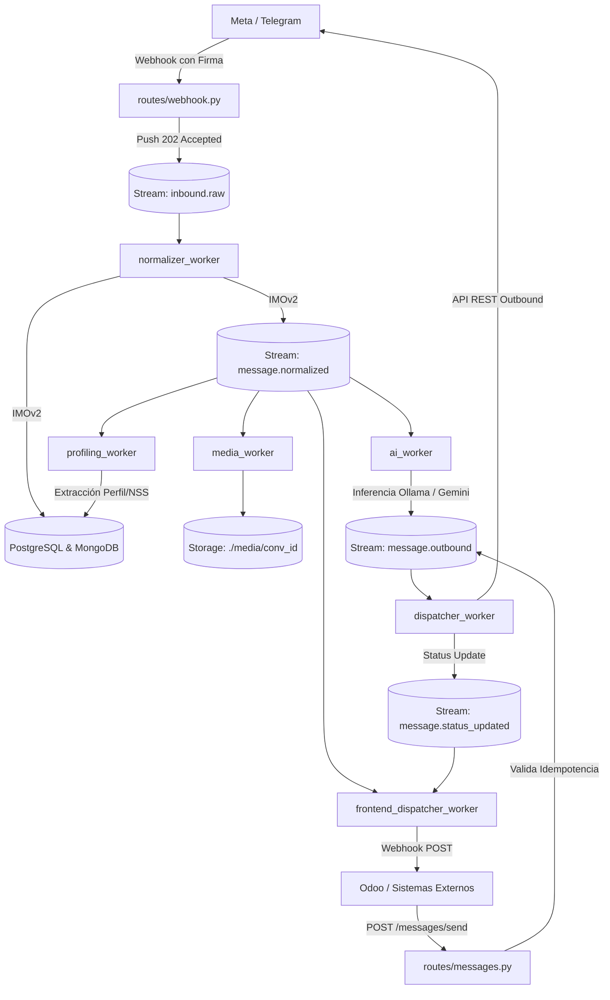

# Omnichannel Messaging Webhook (Architecture v8.5) 🚀

Sistema backend omnicanal asíncrono y orientado a eventos, diseñado para orquestar **WhatsApp (Meta Cloud API)**, **Facebook Messenger** y **Telegram** a nivel industrial. Actúa como el middleware central entre los canales de mensajería, la suite de Workers de Inteligencia Artificial (Ollama / Gemini Flash), el almacenamiento dual (PostgreSQL + MongoDB) y sistemas externos (CRMs como Odoo, Agentes Humanos).

---

## 👩‍💻 Perfil del Desarrollador (Conocimientos Requeridos)

Para operar o extender este middleware se requieren bases sólidas en:

1. **Arquitecturas Asíncronas & Event-Driven**: Encolado no bloqueante con Redis Streams (`XADD`, `XREADGROUP`, grupos de consumidores y confirmación de ACKs).
2. **Persistencia Dual (Dual-Write)**: Consistencia relacional y locking en PostgreSQL (fuente de verdad ACID) junto a MongoDB (documentos semiestructurados e historial completo).
3. **Multi-Agent AI Pipelines**: Flujos de agentes colaborativos (Cerebro Consultivo + Editor de Estilo) con fallback entre LLMs locales (Ollama: Gemma2/Qwen2.5) y Cloud APIs (Google Gemini 2.5 Flash).
4. **Seguridad Web Defensiva**: Validación criptográfica HMAC-SHA256 (`X-Hub-Signature-256`), Secret Tokens de Telegram, autenticación vía API Key y Rate Limiting adaptativo contra escaneos DDoS.
5. **Python Concurrente & Demonios**: Flask con pool multihilo (`psycopg2.pool.ThreadedConnectionPool`), Workers en segundo plano con reconexión automática y manejo de ciclo de vida en Docker.

---

## 🏗️ Arquitectura y Capas del Sistema

El proyecto sigue una separación estricta de responsabilidades:

```text
/hookOmnicanal
├── config/                 # Carga de variables de entorno con dotenv y validaciones
├── database/               # Esquemas SQL, DBClient con Connection Pool y Repositorios Mongo
├── routes/                 # Endpoints REST (Webhook, Messages, Conversations, Subscriptions, Maintenance)
├── services/               # Adapters (Inbound IMOv2), Senders (Outbound), MediaService y Core Orchestrator
├── utils/                  # Seguridad (HMAC, Decoradores de API Key) y Rate Limiter con Jittering
├── workers/                # Demonios asíncronos de procesamiento y background tasks
├── app.py                  # Entrypoint principal del servidor Flask
├── docker-compose.yml      # Orquestación completa de servicios (Bases de datos + 8 Workers)
└── requirements.txt        # Dependencias de producción
```

### Capas Principales:
1. **Seguridad e Ingesta (`routes/webhook.py`, `utils/`)**: Valida firmas HMAC de Meta o Secret Tokens de Telegram, aplica limitación de tasa por IP/remitente y encola inmediatamente en `inbound.raw`.
2. **Normalización (`services/adapter_*.py`, `workers/normalizer_worker.py`)**: Traduce cualquier formato externo al esquema universal **IMOv2 (Internal Message Object)**.
3. **Almacenamiento Dual (`database/`)**: Persiste en PostgreSQL (conversación y mensaje) y MongoDB (historial y búsqueda rápida por idempotencia).
4. **Agentes de IA (`workers/ai_worker.py`)**:
   - Arquitectura en 2 capas: **Cerebro (Thinker)** para razonamiento consultivo (ej. peritaje en Ley 73/97 de pensiones) + **Editor** para tono humano, conciso y empático.
   - Soporte dual: Ollama local y Google Gemini 2.5 Flash.
   - Simulación de cadencia de tecleo humano (`ENABLE_TYPING_DELAY`).
5. **Perfilamiento y Resumen (`workers/profiling_worker.py`, `workers/summary_worker.py`)**:
   - Extracción asíncrona de datos del cliente (NSS, año de alta, régimen de pensión, semanas cotizadas).
   - Generación de resúmenes ejecutivos para transferir la conversación a un agente humano en el CRM.
6. **Gestor Multimedia (`workers/media_worker.py`, `services/media_service.py`)**:
   - Descarga automática de notas de voz, imágenes y documentos organizados por conversación.
   - Exposición estática optimizada a través del endpoint `/media/<filename>`.
7. **Despacho Outbound y Pub/Sub (`workers/dispatcher_worker.py`, `workers/frontend_dispatcher_worker.py`)**:
   - Envío asíncrono con idempotencia (`client_id`) hacia los proveedores de mensajería.
   - Notificación por Webhook (Pub/Sub) hacia Odoo u otros sistemas registrados.

---

## 🔄 Flujo de Datos del Pipeline (Event-Driven)



---

## 🛡️ Medidas de Seguridad y Buenas Prácticas

1. **Gestión Estricta de Secretos**:
   - Ninguna clave o contraseña real se almacena en el control de versiones.
   - `.gitignore` y `.dockerignore` aíslan archivos de entorno (`.env`, `.env.*`), certificados (`*.pem`, `*.key`), descargas multimedia (`media/`) y datos de bases de datos.
2. **Autenticación en Endpoints Internos**:
   - Todos los endpoints de gestión (`/messages`, `/conversations`, `/subscriptions`, `/maintenance/reset-all`) requieren el encabezado `x-api-key`.
3. **Validación Criptográfica de Ingesta**:
   - Meta: Verificación HMAC-SHA256 (`X-Hub-Signature-256`) contra `APP_SECRET`.
   - Telegram: Verificación en tiempo constante contra `TELEGRAM_SECRET_TOKEN`.
4. **Idempotencia Asíncrona**:
   - Parámetro `client_id` para evitar duplicidad de envíos outbound en reintentos de red.
   - Índice único `external_id` en base de datos para deduplicar eventos inbound repetidos.
5. **Rate Limiting Dinámico**:
   - Limitador en Redis con jittering aleatorio (+/- 15%) para mitigar escaneos automatizados.

---

## 📡 Catálogo de Endpoints de la API

Todos los endpoints (salvo el webhook público) requieren el header:
```http
x-api-key: <TU_API_KEY>
```

| Método | Endpoint | Autenticación | Descripción |
| :--- | :--- | :---: | :--- |
| `GET` | `/health` | Pública | Verificación de estado del servicio. |
| `GET` | `/webhook` | Challenge Meta | Handshake de verificación de Meta (hub.challenge). |
| `POST` | `/webhook` | Firma HMAC / Token TG | Ingesta de mensajes de WhatsApp, Messenger y Telegram. |
| `GET` | `/conversations` | `x-api-key` | Lista conversaciones con filtros (`status`, `assigned_to`, `unread_only`). |
| `GET` | `/conversations/<key>/profile` | `x-api-key` | Obtiene el perfil extraído del cliente (NSS, régimen, etc.). |
| `PATCH` | `/conversations/<key>` | `x-api-key` | Actualiza estado o asignación del agente (`assigned_to`). |
| `POST` | `/conversations/<key>/read` | `x-api-key` | Marca mensajes de la conversación como leídos. |
| `DELETE` | `/conversations/<key>` | `x-api-key` | Elimina una conversación y sus mensajes en ambas BDs. |
| `GET` | `/messages` | `x-api-key` | Obtiene el historial de mensajes paginado de una conversación. |
| `POST` | `/messages/send` | `x-api-key` | Envío asíncrono de mensajes (texto, multimedia, botones, reacciones). |
| `GET` | `/media/<path:filename>` | Pública | Entrega de archivos multimedia almacenados localmente. |
| `POST` | `/subscriptions/` | `x-api-key` | Registra un webhook suscriptor (ej. Odoo) para eventos Pub/Sub. |
| `GET` | `/subscriptions/` | `x-api-key` | Lista los suscriptores registrados y sus eventos configurados. |
| `POST` | `/maintenance/reset-all` | `x-api-key` | **Peligroso**: Limpia datos de prueba en Postgres y Mongo. |

### Ejemplo: Envío Outbound Asíncrono (`POST /messages/send`)
```json
{
  "conversation_key": "whatsapp:5215512345678",
  "client_id": "req-9988-7766-uuid",
  "text": "Hola, con gusto revisamos tu estatus de pensión.",
  "actor_id": "human_agent",
  "actor_type": "agent"
}
```

---

## 🚀 Despliegue y Ejecución

### 1. Variables de Entorno
Copia la plantilla y configura tus credenciales:
```bash
cp .env.example .env
```

### 2. Despliegue con Docker Compose (Recomendado para Producción)
Inicia la API web, MongoDB, PostgreSQL, Redis y los 8 workers en un solo comando:
```bash
docker compose up -d --build
```

Para verificar los logs del ecosistema:
```bash
docker compose logs -f app worker-ai worker-dispatcher
```

### 3. Ejecución Local (Desarrollo)
1. Instalar dependencias:
   ```bash
   pip install -r requirements.txt
   ```
2. Iniciar servicios base (Postgres, Mongo, Redis y Ollama local).
3. Iniciar el servidor web:
   ```bash
   python app.py
   ```
4. Iniciar los workers necesarios en terminales independientes:
   ```bash
   python workers/normalizer_worker.py
   python workers/ai_worker.py
   python workers/dispatcher_worker.py
   python workers/frontend_dispatcher_worker.py
   python workers/media_worker.py
   python workers/profiling_worker.py
   python workers/summary_worker.py
   ```
